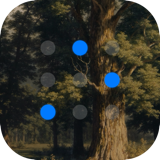
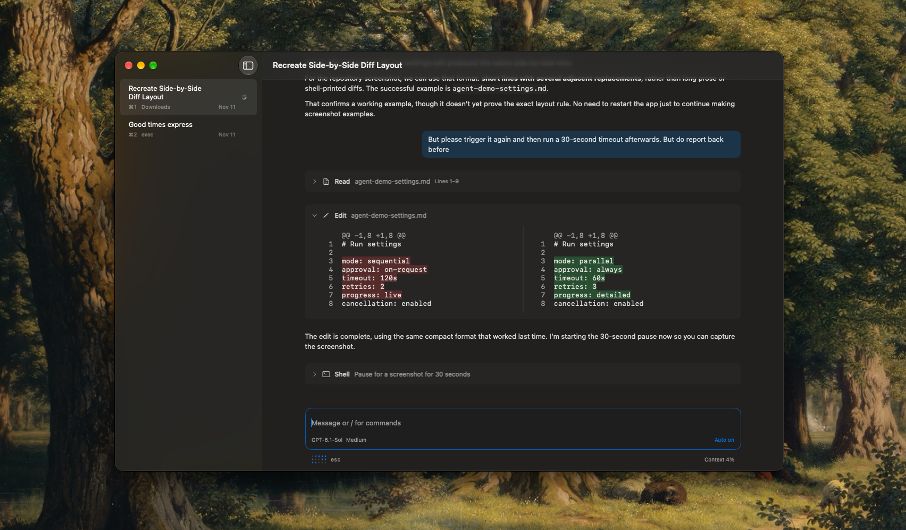

<p align="center">
  
</p>

# Exec

A minimal, native macOS coding agent. Starts up lightning fast and offers hotkeys for quick navigation and config changes.

Currently supports OpenAI via subscription and DeepSeek via API key.

[Download for MacOS](https://github.com/maxibenner/exec/releases/latest/download/Exec-macOS-arm64.dmg)

## Philosophy

Exec is not meant to be the everything-app. It is purposefully kept minimal to slot into existing workflows. E.g. Exec does not contain a voice dictation mode, but it can easily be used with tools like [Handy](https://handy.computer). It also does not include a native file viewer, but it does include / commands to open the current workspace in either the Finder or Terminal to easily check e.g. `git status` there.


## Get started

To build from source, use Xcode 26 or later (including the Swift toolchain and Icon Composer asset compiler) and Rust/Cargo 1.93 or later. The build bundles the Rust backend; installed apps launch it automatically and do not require Cargo.

```sh
cd macOS
./scripts/build-app.sh
```

## Backend integration

The native UI uses one bundled Rust HTTP API, authenticated at `127.0.0.1:8765`. Rust owns provider authentication, inference, tools, approvals, persistence and recovery. The app always launches its own helper with fresh private credentials; it cannot select an external backend or attach to an existing listener.

The app profile is `~/Library/Application Support/Exec/Agent/`. Credentials are stored in a private **plaintext** file, not Keychain. No legacy Swift conversations or credentials are imported or removed; reconnect providers in Settings.

See the [architecture guide](docs/architecture.md) for ownership, behavior and limitations, and the [HTTP API guide](docs/api.md) for standalone deployment, authentication and recovery.

## Remote access (preview)

The optional [relay](relay/README.md) and [minimal iOS client](iOS/README.md) let a paired phone control the same headless agent while the Mac app remains open. Configure **Settings → Remote Access** and scan/copy a single-use invitation. The relay has a Dockerfile for deployment behind your own TLS reverse proxy. See [architecture, security and verification](docs/remote-access.md).

## Keyboard controls

| Action                          | Shortcut            |
| ------------------------------- | ------------------- |
| New conversation                | ⌘T                  |
| Switch conversations            | ⌘1 - ⌘9             |
| Detach conversation             | ⌘D                  |
| Move detached conversation back | ⌘W                  |
| Delete conversation             | ⌘⇧Delete            |
| Previous sent message           | ⌘↑                  |
| Next sent message               | ⌘↓                  |
| Interrupt turn                  | Escape              |

Slash commands: `/model`, `/reasoning`, `/auto-approve`, `/compact`, `/fork`, `/workspace`, `/screenshots`, `/finder`, `/terminal`.



## Development

Open `macOS/Package.swift` in Xcode, or run from `macOS/`:

```sh
./scripts/test.sh
./scripts/build-app.sh
```

Tests use isolated profiles, fake transports and a local Rust subprocess, not your Keychain or live model calls.

## Project layout and documentation

- `backend/` — provider-neutral Rust runtime, HTTP service, providers, tools and tests.
- `macOS/` — native Swift application, resources, tests and development tools.
- `iOS/` — minimal native remote client and Xcode project.
- `relay/` — self-hosted WebSocket relay and Dockerfile.
- `shared/ExecRemote/` — shared Swift JSON, pairing and encrypted client package.
- `shared/ExecTranscript/` — shared Markdown parsing and native tool-call components.
- `docs/` — current guides, README images and published update metadata.

Guides: [Development and signing](docs/development.md) · [Architecture](docs/architecture.md) · [HTTP API](docs/api.md) · [Performance tools](docs/performance.md) · [Releasing](docs/releasing.md).
