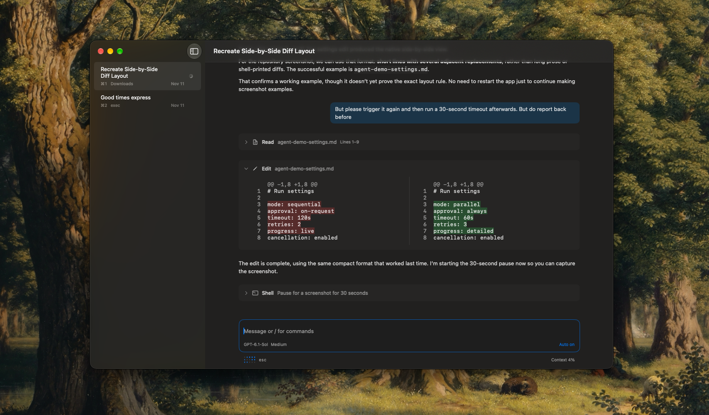

<p align="center">
  
</p>

# Exec

A minimal, cross-platform backend (agent runner and manager), and a swift frontend for macOS and iOS. The current macOS frontend comes bundled with a managed backend process.

Current supported providers are OpenAI via subscriptions and DeepSeek via API key.

## Philosophy

Exec is meant to be a lean, day-to-day, independent, cross-platform agent harness. Run it on your personal computer, or on a server as an always-on assistant.
The frontend is purposefully kept minimal to slot comfortable into existing workflows. For example, Exec does not contain a voice dictation mode, but it can easily be used with tools like [Handy](https://handy.computer). It also does not include a native file viewer, but it does include / commands to open the current workspace in either the Finder or Terminal to easily check e.g. `git status` there.

## Get started

[Download for MacOS](https://github.com/maxibenner/exec/releases/latest/download/Exec-macOS-arm64.dmg)

or build from source. Use Xcode 26 or later and Rust/Cargo 1.93 or later.

```sh
cd macOS
./scripts/build-app.sh
```

## Remote access

The optional [relay](relay/README.md) and [minimal iOS client](iOS/README.md) let a paired phone control the same headless agent while the Mac app remains open. Configure **Settings → Remote Access** and scan the QR-code. The relay has a Dockerfile for deployment behind your own TLS reverse proxy.

## Keyboard controls

| Action                          | Shortcut            |
| ------------------------------- | ------------------- |
| New conversation                | ⌘T                  |
| Switch conversations            | ⌘1 - ⌘9             |
| Detach conversation             | ⌘D                  |
| Move detached conversation back | ⌘W                  |
| Delete conversation             | ⌘⇧Delete            |
| Previous sent message           | ⌘↑                  |
| Next sent message               | ⌘↓                  |
| Interrupt turn                  | Esc              |

Slash commands: `/model`, `/reasoning`, `/auto-approve`, `/compact`, `/fork`, `/workspace`, `/finder`, `/terminal`.



## Development

Open `macOS/Package.swift` in Xcode, or run from `macOS/`:

```sh
./scripts/test.sh
./scripts/build-app.sh
```