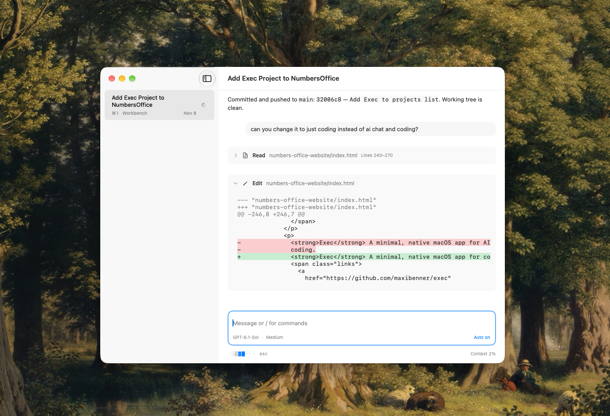

<p align="center">
  
</p>

# Exec

A minimal, native macOS coding agent. Starts up lightning fast and offers hotkeys for quick navigation and config changes.

Currently supports OpenAI via subscription and DeepSeek via API key.

[Download for MacOS](https://github.com/maxibenner/exec/releases/latest/download/Exec-macOS-arm64.dmg)

# Philosophy

Exec is not meant to be the everything-app. It is purposefully kept minimal to slot into existing workflows. E.g. Exec does not contain a voice dictation mode, but it can easily be used with tools like [Handy](https://handy.computer). It also does not include a native file viewer, but it does include / commands to open the current workspace in either the Finder or Terminal to easily check e.g. `git status` there.


## Get started

To build from source, use Xcode 26 or later (including the Swift toolchain and Icon Composer asset compiler):

```sh
cd macOS
./scripts/build-app.sh
```

## Keyboard controls

| Action                          | Shortcut            |
| ------------------------------- | ------------------- |
| New conversation                | ⌘T                  |
| Switch conversations            | ⌘1 - ⌘9             |
| Detach conversation             | ⌘D                  |
| Move detached conversation back | ⌘W                  |
| Delete conversation             | ⌘⇧Delete            |
| Interrupt turn                  | Escape              |

Slash commands: `/model`, `/reasoning`, `/auto-approve`, `/compact`, `/workspace`, `/finder`, `/terminal`.



## Remote Access

Follow conversations, create conversations in Mac folders, send text and stop turns from a browser. Install Pangolin CLI 0.21.0 once, then configure **Settings → Remote Access** with your site's connection details and resource URL. Exec manages the foreground connector and serves both the frontend and API at `http://127.0.0.1:9417`; no separate website, relay, or system service is needed. Existing externally managed connectors remain supported.

Remote Access is off by default. Pangolin—not an additional Exec login—controls remote access. Public resources must require authentication across the frontend and all API routes; private resources require Pangolin client authentication and restricted permissions. Local processes on the Mac are trusted. Site credentials stay in Keychain. Tool approvals stay on the Mac, and existing auto-approval settings still apply.

See the [setup and security guide](docs/remote-access.md) for resource policies, the reviewed CLI limitations, lifecycle behavior, and interrupted connections.

## Development

Open `macOS/Package.swift` in Xcode, or run from `macOS/`:

```sh
./scripts/test.sh
./scripts/build-app.sh
```

Tests use isolated stores and fake transports, not your Keychain or live model calls.

For consistent Keychain access across rebuilds, configure a stable signing certificate:

```sh
security find-identity -v -p codesigning
git config --local exec.signingIdentity "<certificate SHA-1>"
REQUIRE_STABLE_SIGNING=1 ./scripts/build-app.sh
```
